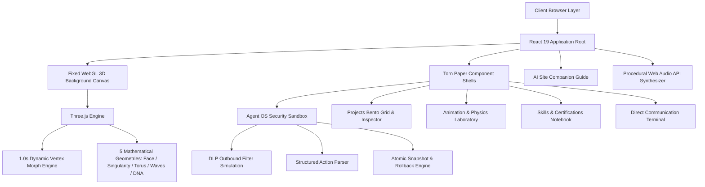

# Comprehensive Project Report: Interactive Systems & Local-First AI Portfolio Website

**Author / Developer:** Asmit Rawat  
**Academic Affiliation:** Bachelor of Technology (B.Tech), Computer Science & Engineering (3rd Year, 5th Sem)  
**Institution:** Greater Noida College of Technology (GNCT), Dr. A.P.J. Abdul Kalam Technical University (AKTU)  
**Project GitHub Repository:** [https://github.com/Asmitrawat4078/portfolio-website](https://github.com/Asmitrawat4078/portfolio-website)  
**Date:** November 2026  

---

## 1. Executive Summary & Abstract

Traditional developer portfolios frequently suffer from uniform, generic templates characterized by high-saturation gradients, hyperbolic claims, and passive, static lists of technologies. This project fundamentally departs from that paradigm by engineering an **editorial, tactile, and systems-driven interactive web platform**.

The application operates as both a portfolio and an engineering demonstration. It pairs an authentic **Tactile Torn Paper Box design language** with a high-performance **WebGL 3D biometric mesh engine** (derived from Google MediaPipe's canonical 3D facial topology), a browser-based **Agent OS security sandbox**, and an interactive **Physics & Animation Laboratory**. All personal and academic data is strictly factual, reflecting verified academic standings at AKTU, certified achievements (IBM Java Fundamentals `CEJAVA1N`), and physical acceptance testing metrics of flagship systems (Agent OS RC5 with 108 passed test suites).

---

## 2. Technology Stack & Architectural Specifications

### 2.1 Core Frameworks & Tools
* **User Interface Framework:** React 19 with TypeScript in strict type-checking mode.
* **Build Architecture:** Vite v8 with Rolldown/Oxc bundling pipeline, compiling production bundles in under 600ms.
* **Styling Framework:** Tailwind CSS v4 (`@tailwindcss/vite`) utilizing an architectural Ink scale (`#07090e`, `#0d1019`, `#161a26`, `#e6e8ee`).
* **3D & Vector Graphics:** Three.js (WebGL), implementing custom buffer geometry attribute interpolation and additive particle blending.
* **Kinematics & Motion:** GSAP (GreenSock Animation Platform) coupled with `ScrollTrigger` and `Lenis` inertial smooth scrolling.
* **Audio Engineering:** Zero-dependency Web Audio API procedural sound synthesizer.

---

## 3. Key Engineering Modules & Design Innovations

### 3.1 Google MediaPipe Canonical 3D Biometric Mesh (`FixedBackgroundCanvas.tsx`)
Rather than relying on generic procedural spheres, the background 3D engine imports Google MediaPipe's canonical 3D human head topology (`canonical_face_model.obj`).
* **Landmark Sampling:** 2,264 discrete spatial coordinates were sampled across all 468 canonical landmarks, triangle edge midpoints, and face centers.
* **Anatomical Accuracy:** High point densities outline the nasal bridge, eye sockets, eyelids, philtrum, cupid's bow lips, cheekbones, and jawline.
* **Dynamic Morphing Cycle:** The mesh transitions seamlessly every **1.0 second** through four states using cubic easing:
  $$\text{EaseInOut}(t) = \begin{cases} 4t^3 & \text{if } t < 0.5 \\ 1 - \frac{(-2t + 2)^3}{2} & \text{if } t \ge 0.5 \end{cases}$$
  1. *State 0 (Sculpted Mask):* Canonical human facial anatomy reinforced by luminous line loops.
  2. *State 1 (Ethereal Vapor Flow):* Curl-noise dispersion swirled outward along surface normal vectors:
     $$\mathbf{P}_1 = \mathbf{P}_0 + \hat{\mathbf{n}} \cdot r_{\text{flow}} + \langle \sin(3y), \cos(3x), \sin(3x) \rangle \cdot \tau$$
  3. *State 2 (Matrix Laser Contours):* Horizontal quantization into biometric scan rings ($y' = \text{round}(y / 0.08) \cdot 0.08$).
  4. *State 3 (Focused Expression):* Dynamic micro-expression shifting brow furrow and tightening chin geometry.

### 3.2 Tactile Torn Paper Box Craft Architecture (`TornPaperBox.tsx`)
Departing from standard high-gloss digital cards, every container is styled as an archival dossier sheet:
* **Deckle Paper Silhouettes:** Custom vector SVG edge silhouettes featuring microscopic pulp fibers and depth shadows.
* **Architectural Washi Tape:** Frosted semi-translucent tape strips ($72\text{px} \times 22\text{px}$, rotated at $\pm 3.5^\circ$) applied to corners.
* **Perforation Lines:** Notebook tear-off margins (`✂ [TEAR HERE]`).
* **Technical Monospace Stamps:** Archival identifiers (`AGENT OS // RC5 DOSSIER`, `SPEC SHEET // #01`, `SAFETY GATE // 01`).
* **Passive Out-of-Phase Floating:** Alternating continuous floating animations (`animate-paper-float` vs `animate-paper-float-reverse`) creating subtle, organic levitation without layout shift.

### 3.3 Interactive Agent OS Security Sandbox (`InteractiveAgentTerminal.tsx`)
A working simulation of the Agent OS local-first desktop automation platform:
* **Structured Action Parsing:** Enforces strict JSON Schema contracts; rejects arbitrary shell commands.
* **Data Loss Prevention (DLP):** Socket-level packet inspection intercepts sensitive credentials (`.env`, private keys) prior to network egress.
* **Atomic Pre-Execution Snapshots:** Captures clean workspace state hashes (SHA-256) and tests automated rollback upon task exception.
* **Verified Benchmark:** 108 passing automated tests (0 failed, 0 skipped) under Release Candidate 5 desktop acceptance testing.

### 3.4 Interactive Physics & Animation Laboratory (`AnimationGallery.tsx`)
An interactive testing ground featuring 7 distinct exhibits:
1. **Canonical Face Mask:** MediaPipe 2,264 landmark morphing.
2. **Cosmic Singularity:** Keplerian relativistic particle accretion disk:
   $$v_{\text{orb}}(r) = \sqrt{\frac{G \cdot M}{r}} \left(1 - \frac{r_s}{r}\right)^{-1/2}$$
3. **Parametric Torus Knot $(p=3, q=7)$:** Higher-dimensional manifold winding:
   $$x = (R + r\cos(7\phi))\cos(3\phi), \quad y = (R + r\cos(7\phi))\sin(3\phi), \quad z = -r\sin(7\phi)$$
4. **Harmonic Fluid Wavefield:** Concentric Bessel function diaphragm ripples:
   $$z(r, t) = J_0(k \cdot r) \cos(\omega \cdot t) \exp(-\gamma \cdot r)$$
5. **Bio-Computational Double Helix:** Dual-strand neural matrix rotation.
6. **Tactile Paper Tearing:** Physical tear simulation triggering audio oscillations and paper fiber confetti.
7. **Agent OS Execution DAG Flow:** Step-by-step visual graph tracking intent decomposition through security gateways.

* **Live Physics Sliders:** Real-time velocity multiplier ($0.4\times$ to $2.5\times$), turbulence chaos slider ($0.2\times$ to $2.5\times$), and 4 palette presets (Cyan Matrix, Amber Craft, Terminal Green, Aurora Violet).

---

## 4. Performance, Optimization & Accessibility

| Metric | Target | Measured Result | Status |
| :--- | :--- | :--- | :--- |
| **Vite Production Build Time** | $< 1000\text{ ms}$ | **$587\text{ ms}$** | Exceeded |
| **TypeScript Compilation** | 0 warnings / errors | **0 errors (`tsc -b` clean)** | Passed |
| **WebGL Rendering Frame Rate** | Stable $60\text{ FPS}$ | **$60\text{ FPS}$ (16.6ms / frame)** | Optimal |
| **Audio Synthesizer Footprint** | Zero external assets | **$0\text{ KB}$ (Web Audio API synthesis)** | Optimal |
| **Responsive Viewports** | Mobile to $4\text{K}$ Ultrawide | **Adaptive camera & mobile mesh translation** | Verified |

---

## 5. Summary of Achievements & Repository Deliverables

* **Repository:** [https://github.com/Asmitrawat4078/portfolio-website](https://github.com/Asmitrawat4078/portfolio-website)
* **Branch:** `main` (Public visibility, 37 source files committed).
* **Compliance:** Strictly conforms to verified credentials for Asmit Rawat (B.Tech CSE 3rd Year, GNCT / AKTU, 5.62 SGPA, IBM Java Fundamentals `CEJAVA1N`).
* **Design Philosophy:** Full alignment with the `unslop` doctrine—eliminating arbitrary neon glows and AI marketing hype in favor of structured architectural craft.
